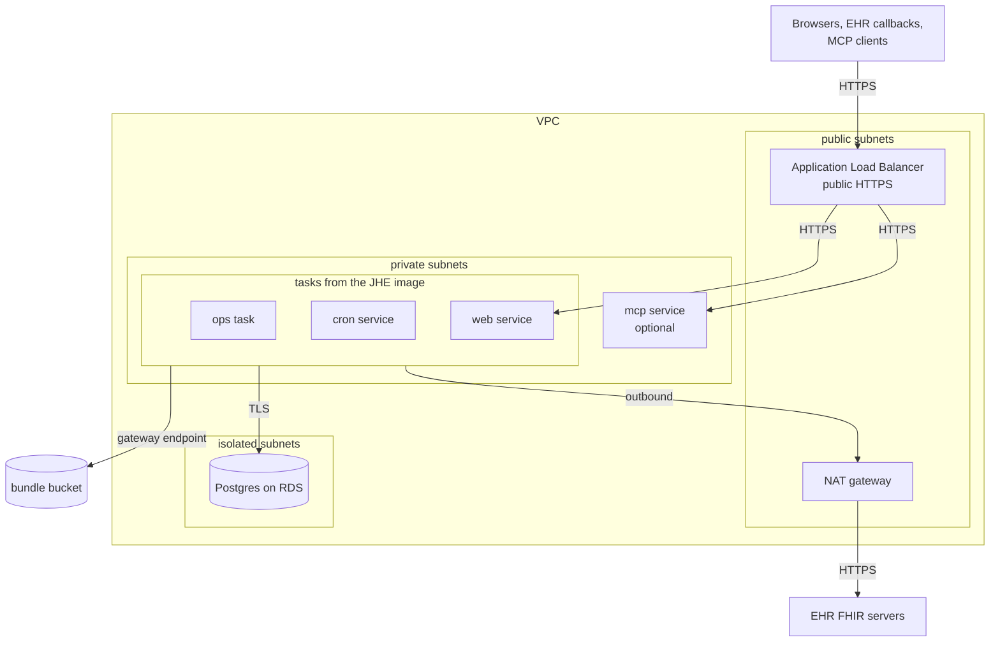

# JupyterHealth Exchange on AWS

A representative deployment of [JupyterHealth Exchange](https://github.com/the-commons-project/jupyterhealth-exchange)
(JHE) on AWS, as CDK code in Python plus one deploy script. It is a working starting point,
written to be read and adapted for your organization, its standards, and its policies.

**Status: exercised as a sandbox only.** Nothing here is certified, and nothing here claims to
satisfy any regulation. [What the defaults assume](#what-the-defaults-assume) says what each
default trades away.

This file has four parts:

- [The design](#the-design): the architecture, what this build chose and why, and what it
  leaves to you.
- [Standing one up](#standing-one-up): from an empty account to a patient's records in the
  bucket. To build a sandbox, start at [the whole sequence](#the-whole-sequence).
- [Operating it](#operating-it): the commands, upgrades, logs, secrets and teardown.
- [Reference](#reference): the repository layout and the deployer policy.

What JHE itself requires of any deployment, on any platform, is a separate document:
[docs/jhe-runtime-requirements.md](docs/jhe-runtime-requirements.md). This file is about one
build that meets those requirements.

## The design

### Architecture



Not drawn: Secrets Manager, which every task reads at start; the KMS key behind the database,
the bucket and the secrets; and the mcp service's calls to JHE, which go out and back in
through JHE's public URL.

Requests reach the ALB in the public subnets and nothing else does: every task runs in the
private subnets with egress through the NAT (the EHRs are on the internet), and Postgres sits
in the isolated subnets with no route out. The ALB terminates the public HTTPS and re-encrypts
to the containers, which serve TLS themselves ([Encryption in transit](#encryption-in-transit)).

Three task definitions run the JHE image, and the boundary that matters is who starts them:

| Task definition | Started by | Privileges |
|---|---|---|
| **web** | ECS, as the service behind the ALB | the application's: its database credentials, the bundle bucket |
| **cron** | ECS, as a one-task service running `supercronic` on the crontab the JHE image ships | the same roles as web |
| **ops** | a person: `jhe-deploy deploy` (migrate, bootstrap), `jhe-deploy run`, `admin create` | the operator's: the same database credentials, the bucket, the first admin's password |

The periodic jobs are the application's own background work, so the cron task gets exactly
the web service's privileges. It runs JHE's crontab as JHE's own compose and Fly deployments
do, so the schedule lives in JHE and a job JHE adds runs here with the next image. Anything a person runs uses the ops task, which holds the union
of what a one-off command might need, so there is no flag to pick. The MCP server is a
further task definition with its own image and no credentials beyond its OAuth client; it reaches JHE
through the public URL.

### The stacks

```
network ──> shared (ECR, cluster)
   │           │
   └──> data ──┴──> ops ──> compute ──> monitoring

access (the deployer policy; depends on nothing)
```

| Stack | Holds | Configuration section | Replaceable |
|---|---|---|---|
| `network` | VPC, subnets, NAT, S3 gateway endpoint, flow logs | `network` | no: termination protection |
| `shared` | ECR repositories, ECS cluster | (none) | no |
| `data` | KMS key, Postgres, the bundle and ALB-log buckets, the database and first-admin secrets, the database security group | `data` | no: everything retained on deletion |
| `ops` | the ops task definition, its role, security group and log group | `ops` | yes |
| `compute` | certificate, ALB, the web, mcp and cron services, DNS records | `compute` | yes |
| `monitoring` | alarms, the SNS topic, the failed-task notification | `monitoring` | yes |
| `access` | the `JheDeployer` managed policy and who holds it | `access` | yes, by `jhe-deploy access` only |

The first three hold everything stateful or slow to replace and carry termination protection.
`ops`, `compute` and `monitoring` can be destroyed and redeployed freely. Each release deploys
`ops` with the new image and runs the migration before `compute` rolls, so a bad image or a
failing migration stops before anything user-facing changes. `access` is outside both groups:
it says who may deploy, an administrator's decision made once, so it has its own command and
`deploy` never touches it ([A narrower deployer](#a-narrower-deployer)).

Four Secrets Manager secrets hold every credential JHE reads; nothing secret is in
configuration, task definitions, images or files:

| Secret | Created by | Holds |
|---|---|---|
| `jhe/<env>/database` | RDS, in the `data` stack | the database host, name, user and password |
| `jhe/<env>/bootstrap-admin` | the `data` stack | the first admin's password |
| `jhe/<env>/service` | `jhe-deploy secrets init` | `SECRET_KEY`, the OIDC key, the patient-access keys, SMTP and Open Wearables credentials |
| `jhe/<env>/mcp` | `jhe-deploy secrets init` | the MCP server's OAuth client and broker key |

The last two are created by the script and only referenced by name from the stacks, so no
stack change can touch their values ([Secrets](#secrets) says why).

### What this build chose

[docs/jhe-runtime-requirements.md](docs/jhe-runtime-requirements.md) lists what JHE needs.
This is what this repository picked for each need, and where to change it. Each is a choice,
not a requirement of JHE.

| JHE needs | This build | Where |
|---|---|---|
| a place to run the web process | ARM64 Fargate service behind an ALB, one task by default | `compute.web` |
| a scheduler for the sweep and the Open Wearables poll | JHE's own: one always-on Fargate task running `supercronic` on the image's crontab, with the web service's roles and its own spool disk. A roll stops the old task before starting the new one, so no job runs twice | `compute.cron` |
| migrate, bootstrap and one-off commands before a release | a separate ops task, run by `jhe-deploy` | `ops` |
| Postgres with TLS | a single RDS Postgres 16 instance with `rds.force_ssl`; the client verifies the server with the RDS CA bundle built into the image | `data`, `data.verify_server_certificate` |
| an S3-compatible bucket for bundles | an S3 bucket, encrypted with the KMS key, reached with the task role and no access keys. It is versioned, old versions expire after 90 days, and incomplete multipart uploads are aborted after a day | `data.bundle_noncurrent_version_days` |
| writable local disk for the spool | 50 GiB of ephemeral storage per web task, and a 120-second stop timeout so a pull in flight has the longest grace Fargate allows | `compute.web.ephemeral_storage_gib` |
| outbound HTTPS to any EHR | a NAT gateway or a NAT instance. Calls to Secrets Manager, ECR and CloudWatch also leave through it; only S3 has an endpoint | `network.nat` |
| two public hostnames with a certificate | an ACM certificate and Route 53 records. The ALB answers only those two hostnames and returns 404 to any other | `compute.dns` |
| HTTPS in front of the web process | TLS at the ALB and again to the containers, on by default; HSTS at one year | `compute.tls_to_tasks`, `compute.hsts_seconds` |
| secrets from a secret store | Secrets Manager, under a customer-managed KMS key | `data.customer_managed_keys` |
| a mail relay, optionally | none: JHE drops its mail, and invitation links are copied from the admin | `compute.email` |
| the MCP server, optionally | a second Fargate service with `MCP_REQUIRE_AUDIENCE` on, which is not the server's default. No rate limiting sits in front of its open `/register` endpoint | `compute.mcp` |
| `DEBUG` never set | `compute.environment` refuses it, along with every variable the stacks set themselves | `jhe_aws/config.py` |

### Encryption in transit

This section explains one design choice. It makes no claim that the design satisfies any
regulation or standard. Whether it meets yours is a judgement for you and your reviewers,
which is why the choice is a setting and the reasoning is written here.

Every hop that can carry patient data, what encrypts it, and where to see it:

| Hop | Encrypted by | Where to see it |
|---|---|---|
| Browser, EHR callback, MCP client to the ALB | ACM certificate; HTTPS listener with the TLS 1.3 policy; HTTP redirected | the listener in the console |
| ALB to the web and MCP containers | TLS terminated in the container (gunicorn and uvicorn serve HTTPS); HTTPS target groups and health checks | the target group's protocol |
| Tasks to Postgres | `rds.force_ssl` on the parameter group, so the server refuses plaintext; `DB_SSLMODE=verify-full` with the RDS CA bundle built into the image, so the client verifies the server | the parameter group; the task definition's environment |
| Tasks to S3, Secrets Manager, ECR, CloudWatch | HTTPS endpoints; the buckets deny non-TLS requests | the bucket policies |
| MCP server to JHE | the public HTTPS URL through the ALB | as the first row |
| Tasks to EHRs | HTTPS; JHE refuses plain-HTTP EHR endpoints unless `DEBUG` is set, which this repository refuses to set | the `compute.environment` validation |

**Why TLS to the containers is on by default.** The common pattern is TLS at the load
balancer and plain HTTP inside the private VPC, which leaves one hop in the clear. Nitro
hardware encryption does not cover traffic through a load balancer. Closing the hop costs one
`openssl` call at container start and HTTPS on the target group.

**How it works.** The public hop and the internal hop are two TLS connections. On the internal
one the container is the server and the ALB is the client. Two certificate sources are
configurable:

- `self-signed` (default): each container issues its own key and certificate at start, never
  shared and never rotated because it lives as long as the task. Validity is ten years so a
  long-running task never presents an expired certificate to anything that checks.
- `provided`: for a policy that forbids self-signed certificates anywhere, mount files issued
  by your CA (the images read `JHE_TLS_CERTFILE`/`KEYFILE` and `MCP_TLS_CERTFILE`/`KEYFILE`).
  The ALB side is identical. Wiring AWS Private CA into the entrypoint is a follow-on.

**What this hop is and is not.** It is encrypted: the session key comes from an ephemeral key
exchange, so a capture of the traffic yields ciphertext, and that does not depend on who
signed the certificate. It is not mutually authenticated: the ALB validates no target
certificate and has no setting for it, so a CA-issued certificate satisfies a policy without
changing what the hop protects; the target's identity rests on the VPC (the address ECS
registered, packet-level authentication, the security groups). A review that wants
cryptographic identity on this hop has two architectural options, neither a setting here: an
NLB in TCP passthrough with a public certificate in the container (the browser then
authenticates the container, at the cost of host routing and the rest of layer 7), or VPC
Lattice (identity by IAM, replacing the ALB layer).

### What it provides, and what it does not

**Provided**

- The architecture above, with every resource encrypted at rest under a customer-managed KMS
  key, TLS required to Postgres and kept to the containers, and no public address on anything
  but the ALB.
- Every credential in Secrets Manager, with the two an operator fills kept outside
  CloudFormation.
- Migrations as a one-off task before each release, and any management command as a one-off
  task on demand: no SSH, no exec into a serving task.
- JHE's periodic jobs on JHE's own schedule, in a task of their own with its own log group.
- DNS records and certificate validation when the hosted zone is in the account; outputs to
  copy when it is not.
- Five alarms (web 5xx, no healthy web target, database storage low, a periodic job failed,
  no periodic job has succeeded for fifteen minutes) and a notification when an ops task
  fails, all to one SNS topic, with an email subscription if you give an address.
- `cdk-nag` AWS Solutions checks at synth, with every suppression's reason in the code.

**Not provided (each is a deliberate follow-on, with the seam left in the code)**

- **Email.** No relay is configured, so JHE drops invitation and one-time-code mail.
  SMTP-relay settings exist in the configuration and the service secret for when you decide
  on a relay or SES.
- Bringing your own VPC (the configuration has an `import` mode; it has not been exercised).
- Aurora, read replicas, RDS Proxy.
- Interface VPC endpoints for Secrets Manager, ECR and CloudWatch.
- A WAF, CloudFront, or any edge beyond the ALB.
- A certificate authority for the container certificates.
- Separate database roles for the application and for migrations: JHE connects as the user
  RDS created, and the ops task holds the same credential.
- A queue and worker for patient-access pulls: they run inside the web process, as JHE ships
  them.
- VPC Encryption Controls, GuardDuty, Security Hub, Config, CloudTrail: account-level choices.
- Published images: you build from the JHE source.

**What you bring**

- An AWS account you can bootstrap CDK in, and a principal with administrator access for that
  one step.
- A domain, and either a Route 53 hosted zone in the account or a way to create two CNAMEs.
- The tooling under [Prerequisites](#prerequisites).
- Your own review.

### What the defaults assume

`config/example.json` is the defaults. The protective ones are on: NAT gateways, deletion and
termination protection, thirty days of logs. The sizing ones are small: one single-AZ
database, one web task. A sandbox turns the protective ones down as well, to run at low cost.

Each row is a place where a choice shows and what it trades away. It is not a production
checklist. What a production deployment needs is decided by your review of your account, your
availability targets and your obligations, and several of those needs (an email relay,
account-level logging and detection, separate database roles) are not in this repository at
all.

| Setting | Default | A sandbox sets | What the smaller value trades away |
|---|---|---|---|
| `network.nat` | `gateway`, one per AZ, about $65 a month for two | `instance`: one t4g.micro NAT instance, about $6 | a managed, redundant NAT |
| `data.deletion_protection`, `termination_protection` | on | off | the guard against deleting data by mistake |
| `log_retention_days`, `data.log_retention_days` | 30 | 7 | anything older; retention obligations run to years, which belong in an archive, not CloudWatch |
| `data.multi_az` | `false`: a single-AZ instance | the same | surviving an AZ failure without a restore from backup |
| `data.instance_class` | `db.t4g.small` | the same | headroom under load |
| `data.backup_retention_days` | 7 | the same | older restore points (RDS allows up to 35 days; longer is your snapshot policy) |
| `compute.web.min_count` | 1 | the same | serving through a task replacement or an AZ failure |
| `monitoring.alarm_email` | one address | the same | a paging integration on the SNS topic |
| `compute.tls_to_tasks.certificate` | `self-signed` | the same | nothing on the wire; a CA-issued certificate is a policy choice ([Encryption in transit](#encryption-in-transit)) |

## Standing one up

### The whole sequence

From an empty account to a patient's records in the bucket, in order. Each step links to the
section that explains it.

Every `jhe-deploy` below is `uv run jhe-deploy -c config/local/<name>.json …` from this
repository, written short.

1. [Prerequisites](#prerequisites): the tooling, an administrator login, and a delegated
   Route 53 hosted zone.
2. [Configuration](#configuration): copy `config/example.json` to `config/local/<name>.json`
   and replace every placeholder.
3. [Bootstrap](#bootstrap), once, as an administrator: `jhe-deploy bootstrap`.
4. [A narrower deployer](#a-narrower-deployer), optional: `jhe-deploy access`.
5. [First deploy](#first-deploy): `jhe-deploy deploy --jhe-path <JHE checkout>`. It stops at
   the secrets check, which is expected. Run `jhe-deploy secrets init`, then `deploy` again.
   About twenty-five minutes in all.
6. [The first admin](#the-first-admin): `jhe-deploy admin create --email <you>`, log in,
   change the password, `jhe-deploy admin forget`.
7. [Registration](#registration): closed until you set an invite code.
8. [Demo data](#demo-data), optional: the development seed and the SMART Health IT sandbox.
9. [Where pulls are delivered](#where-pulls-are-delivered): three settings rows, then
   `patient_access_check`.
10. [Verify a pull](#verify-a-pull): a patient's records arrive in the bucket.
11. [The MCP server](#the-mcp-server), optional: register its client, store the credentials,
    `deploy` again.

Afterwards, `jhe-deploy down` when the environment is idle ([Taking it down](#taking-it-down)).

### Prerequisites

**Tooling**, on the machine you deploy from:

- Python 3.12 with [uv](https://docs.astral.sh/uv/), then `uv sync` in this repository.
- Node 22 or later and the CDK CLI: `npm install -g aws-cdk`. This was exercised with CLI
  2.1148.
- Docker with buildx. On an x86 Linux host, arm64 builds need QEMU:
  `docker run --privileged --rm tonistiigi/binfmt --install arm64`. The Docker daemon has to
  be running when the image step starts, about ten minutes into the first deploy.
- The AWS CLI, logged in to the account as an administrator for the first steps.
- A checkout of JHE recent enough to have `manage.py bootstrap` and `DB_SSLMODE`.

**DNS.** The web host and the MCP host must be the apex of, or inside, a Route 53 hosted zone
in the account, and that zone must be delegated from its parent on the public internet, or
ACM cannot validate the certificate. `dig NS <zone>` should answer with the zone's four name
servers. Note the zone's id from its page in the Route 53 console; the configuration needs
it. Without a zone in the account, see
[DNS without a zone in the account](#dns-without-a-zone-in-the-account).

### Configuration

One flat JSON file per environment. `config/example.json` is the committed statement of the
defaults: every key, at the value the code uses when the key is absent (a test holds the two
together). Copy it to `config/local/<name>.json` (gitignored: it carries your account id, zone
id and domain names), replace every `<placeholder>`, and change what you need; keeping the
rest makes the file say what it does. Each section is the knobs of one stack
([The stacks](#the-stacks)). [What the defaults assume](#what-the-defaults-assume) lists what a
sandbox changes.

Unknown keys are refused at synth, and so is any placeholder left in place, so a misspelled
key is an error rather than a silently ignored setting. The models are in `jhe_aws/config.py`.

Nothing secret goes in the file. Secrets live in Secrets Manager and are *named* by the
deployment.

Every `jhe-deploy` command takes `--config` (or `-c`), the environment's file; the
environment's name comes from it. `--profile <name>`, before the subcommand, picks an AWS CLI
profile.

### Bootstrap

Once, with administrator access. The CDK bootstrap creates the roles every later deploy
assumes.

```sh
uv run jhe-deploy -c config/local/<name>.json bootstrap
```

It takes the account, region and qualifier from the configuration file. Use this and not a
bare `cdk bootstrap`: the CDK CLI synthesizes the app even to bootstrap, and would stop on
the example file's placeholders.

`bootstrap --execution-policies <policy arn>` narrows the role CloudFormation deploys with; by
default it is administrator.

### A narrower deployer

Optional. Every deploy needs no more than the `JheDeployer-<env>` managed policy, and an
administrator already has all of it. To let a narrower identity deploy, run, as an
administrator,

```sh
uv run jhe-deploy -c config/local/<name>.json access
```

which deploys the `access` stack: the policy, attached to the IAM users and roles the optional
`access` section of the configuration names. It depends on no other stack, so it can come
before or after the first deploy, and `deploy` never touches it; run it again when the section
changes.

With IAM Identity Center (SSO), leave the section empty and bind the policy through a
permission set instead:
[The deployer policy with IAM Identity Center](#the-deployer-policy-with-iam-identity-center).
What the policy allows is under [The deployer policy](#the-deployer-policy).

### First deploy

```sh
uv run jhe-deploy -c config/local/sandbox.json deploy --jhe-path ../jupyterhealth-exchange
```

which does, in order, and stops at the first failure:

1. **Foundation**: the `network`, `shared` and `data` stacks. Postgres takes about ten
   minutes.
2. **Images**: `docker buildx build --platform linux/arm64` of the JHE image and the MCP image
   from the checkout, pushed to the two repositories, and the digests read back. From here on
   the stacks name those digests; a tag never appears in a task definition. The tag each push
   gets, `<commit>[-dirty]-<build time>`, is what `status` and the end of `deploy` print next
   to each digest, and the image's OCI labels (`org.opencontainers.image.revision`, `created`,
   `source`) say the same from inside it, wherever it is copied.
3. **Secrets**: refuses to go on while `jhe/<env>/service` does not exist or a required field
   of it is empty. On the first deploy that is expected: run

   ```sh
   uv run jhe-deploy -c config/local/sandbox.json secrets init
   ```

   which creates the `jhe/<env>/service` and `jhe/<env>/mcp` secrets under the data key if
   they do not exist, generates Django's `SECRET_KEY`, the OIDC signing key, the
   patient-access encryption key and the MCP broker key, and never overwrites a value. It can
   run as soon as the data stack exists. Then deploy again; the images are rebuilt from
   cache, or pass the digests the first run printed with `--web-image` and `--mcp-image`.
4. **Ops, migrate, bootstrap**: the `ops` stack at the new digest, then `manage.py migrate`
   and `manage.py bootstrap` as the ops task, with the logs printed. Bootstrap is JHE's own
   idempotent command for what a migrated database lacks, the `JHE Admin UI` OAuth
   application the browser login needs among it. A failing migration stops here, with the old
   image still serving.
5. **Compute**: the `compute` and `monitoring` stacks: the certificate (requested and, with a
   Route 53 zone in the account, validated during the deploy), the ALB and the web, MCP
   and cron services. The services roll with a deployment circuit breaker that rolls back on failure.

The result is the web URL. Until the MCP client's credentials are stored, `deploy` says it is
leaving the MCP service off and why ([The MCP server](#the-mcp-server)).

### The first admin

```sh
uv run jhe-deploy -c config/local/sandbox.json admin create --email you@example.org
```

runs `createsuperuser` as the ops task with a password that lives only in the secret
`jhe/<env>/bootstrap-admin`:

```sh
aws secretsmanager get-secret-value --secret-id jhe/<env>/bootstrap-admin --query SecretString --output text
```

Use an address the demo seed does not create (`admin@example.com` is its). Log in at the web
URL, change the password, then `jhe-deploy admin forget`, which replaces the secret's value
with one nobody has read. Never delete the secret: the ops task reads it at every start.

### Registration

Registration is closed until an admin sets `site.registration_invite_code` under Settings; a
visitor then needs that code to self-register. Leave it unset if admins create every user.

### Demo data

Optional. The development fixture creates demo organizations, patients and users on top of
what `bootstrap` made:

```sh
uv run jhe-deploy -c config/local/sandbox.json run -- python manage.py seed --with-rich-demo
uv run jhe-deploy -c config/local/sandbox.json run -- python manage.py seed_patient_access_sandbox
```

The first is written for localhost: every user it creates, `admin@example.com` included, has
the password `Jhe1234!` (the roster is in JHE's `docs/seed-data.md`) and it sets the invite
code to `jhe`. On a public host, change the passwords or delete the users and change the
code. Never pass `--flush-db`. The second puts the SMART Health IT sandbox "hospitals" into
the EHR tables, so a pull can be tried without an EHR account; it updates in place and is
safe to rerun. Without the seed, create an organization and a study in the web UI, and
`seed_rich_demo --organization <name>` can still add the synthetic cohort to it.

### Where pulls are delivered

The USCDI Patient Access module writes each bundle to the bundle bucket, and reads where from
JHE settings rows, not the environment. They do not exist until you create them: under
Settings in the web UI, *Add System Setting*, type `string` (or Django admin, *JHE
settings*):

| Setting | Value |
|---|---|
| `patient_access.s3.bucket` | the bundle bucket, which `status` prints |
| `patient_access.s3.region` | the environment's region |
| `patient_access.s3.encryption` | `bucket-default` (the bucket encrypts with its KMS key) |
| `patient_access.s3.access_key_id`, `secret_access_key` | do not create them: the task role is used |

Until they are set, a pull sits at "Starting" and the web log says `settings not usable`. Then

```sh
uv run jhe-deploy -c config/local/sandbox.json run -- python manage.py patient_access_check
```

which reads the settings as a job would and writes and deletes a marker in the bucket.

### Verify a pull

This uses the demo data: a manager and a patient from the seed, and the SMART Health IT
sandbox in place of an EHR.

1. Log in as a manager (`manager_mary@example.com` after the seed) and open a patient (the
   seed's patient 40001, say).
2. *Generate Invitation Link* with the *USCDI Patient Access* client, and open the link.
3. Agree to share, pick *SMART Sandbox Express (no login, fixed patient)* and continue.
4. "Importing your records" runs to completion.

Then check the result:

```sh
aws s3 ls s3://<bucket> --recursive
uv run jhe-deploy -c config/local/sandbox.json logs web --filter job
```

The first shows the bundle, the second the job's log lines. JHE's
`patient_access/scripts/validate_patient_access_bundle.py` checks the file.

### The MCP server

The MCP service deploys once its OAuth client exists in JHE. Register it at `/admin/` with
the fields listed in
[the requirements document](docs/jhe-runtime-requirements.md#the-mcp-servers-oauth-client),
using `https://<mcp host>/oauth/callback` as the redirect URI. Copy the client secret before
saving: it is hashed on save and never shown again.

Then store the two values and deploy again, with the digests `status` prints so nothing is
rebuilt:

```sh
uv run jhe-deploy -c config/local/sandbox.json secrets set --secret mcp JHE_CLIENT_ID=... JHE_CLIENT_SECRET=...
uv run jhe-deploy -c config/local/sandbox.json deploy --web-image sha256:... --mcp-image sha256:...
```

The values are on the command line, so they land in your shell history; in zsh a leading space
keeps a line out when `HIST_IGNORE_SPACE` is set. The certificate is replaced to add the MCP
host, which takes a few minutes.

### DNS without a zone in the account

Set `compute.dns.mode: external`. The compute deploy pauses at the certificate until you
create the validation CNAME it reports in the stack's events; then create CNAMEs for the two
hosts to the `AlbDnsName` output. Or pass an existing certificate's ARN as
`compute.dns.certificate_arn`.

## Operating it

### Commands

```sh
uv run jhe-deploy -c config/local/sandbox.json status            # stacks, database, bucket, images, URLs
uv run jhe-deploy -c config/local/sandbox.json logs web --since 1h --filter '?job ?Traceback'
uv run jhe-deploy -c config/local/sandbox.json logs cron --filter '"error running command"'
uv run jhe-deploy -c config/local/sandbox.json run -- python manage.py patient_access_check
uv run jhe-deploy -c config/local/sandbox.json secrets show      # which fields are set
uv run jhe-deploy -c config/local/sandbox.json down              # compute off, database stopped
uv run jhe-deploy -c config/local/sandbox.json up                # back, same digests
uv run jhe-deploy -c config/local/sandbox.json restart           # fresh tasks, same image
```

`run` executes the command as the ops task, with its role and credentials: a script that
prunes or exports bundles, a data fix, a check. The periodic jobs never run this way.

`restart` starts a new deployment of the web, MCP and cron services on their current image. The
tasks read their secrets at start, so a changed secret value needs it.

`build --jhe-path <checkout>` builds and pushes both images and prints their digests, without
deploying; `deploy --web-image … --mcp-image …` then deploys them, or rolls back to any
earlier pair (`aws ecr describe-images` lists what the repositories hold, and the ops stack's
`WebImageDigest` output is what is running).

`deploy --skip-migrate` deploys without running `migrate` and `bootstrap`. It is for a
redeploy of the same JHE version, never for an upgrade.

### Upgrading JHE

Check out the new ref and run `deploy --jhe-path` again. The sequence is the same; the
migration runs before the roll. The JHE project's own upgrade notes (stop, check out the tag,
migrate, start) describe a source checkout; here the release is the image and `deploy` does
those steps.

### Logs

`/jhe/<env>/web` (one stream per task), `/jhe/<env>/cron` (supercronic and every periodic
job's output), `/jhe/<env>/mcp`,
`/jhe/<env>/ops` (one stream per command, `ops/jhe/<task id>`), `/jhe/<env>/vpc-flow-logs`,
and Postgres logs under RDS. `log_retention_days` sets how long the task and flow logs are
kept, `data.log_retention_days` the Postgres logs. ALB access logs go to their own bucket and
expire after three times `log_retention_days`.

### Secrets

`jhe/<env>/service` and `jhe/<env>/mcp` are created by `secrets init`, not by a stack.
CloudFormation regenerates a secret's value on any change to how it is generated, which would
empty every field an operator filled. The stacks only reference the two by name, so no stack
change can touch their values, and they outlive every stack.

Should a value ever be lost, Secrets Manager keeps the previous version as `AWSPREVIOUS`
until the next change: `secrets restore-previous --secret service` puts it back. The deploy's
secrets check is what stops a deploy with emptied keys from reaching the tasks.

To rotate a key, `secrets set` the new value and `restart`.
[The requirements document](docs/jhe-runtime-requirements.md#rotating-keys) says what each
rotation invalidates; the patient-access keys are a list, and a new key is prepended, not
swapped in. The database password is RDS's; attach the RDS rotator when the application has
its own role.

### Taking it down

`down` destroys the `compute` and `monitoring` stacks and stops the database (AWS restarts a
stopped instance after seven days). `ops` holds nothing running and stays, and so does
everything stateful. `up` starts the database and redeploys the images `down` left running.

A full teardown is `uv run cdk destroy -c config=config/local/<name>.json <stack names>` of
the remaining stacks after removing termination protection. The database leaves a snapshot,
and the buckets, the KMS key and all four secrets are retained, so patient data outlives the
stacks until you delete it deliberately. Bundle versions older than
`data.bundle_noncurrent_version_days` expire on their own; a deletion request means deleting
every version of the patient's objects.

### The periodic jobs

The cron task runs `supercronic /code/deploy/crontab` from the JHE image: the patient-access
sweep every minute and the Open Wearables poll every fifteen, or whatever the crontab of the
JHE version you deployed says. To change a schedule, change the crontab in JHE and deploy.

Supercronic outlives a failing job, so a failure is a log line and not a stopped task. Two
alarms read the cron log: one fires when a job exits non-zero, the other when no job has
succeeded for fifteen minutes, which means the scheduler is stopped or every job is failing.
`compute.cron.enabled: false` removes the task and both alarms.

### Health

The target groups probe `GET /health` on each container, a liveness check that answers
whatever Host header the probe carries. There is deliberately no readiness check that touches
the database: ECS replaces tasks that fail the ALB probe, so a database blip would cycle
tasks; the 5xx alarm covers that case.

## Reference

### Layout

```
app.py                      CDK entry; context: config, web_image, mcp_image, mcp_enabled, nag
jhe_aws/config.py           the configuration models (pydantic, extra keys refused)
jhe_aws/images.py           digests, never tags
jhe_aws/stacks/
  network.py                VPC, NAT, the S3 gateway endpoint, flow logs
  access.py                 the deployer policy and who holds it
  shared.py                 ECR, ECS cluster
  data.py                   KMS key, Postgres, buckets, the database and first-admin secrets
  jhe_container.py          the JHE container's environment, secrets, roles and outputs, used twice
  ops.py                    the ops task definition
  compute.py                certificate, ALB, web, MCP and cron services, DNS
  monitoring.py             alarms and the failed-task notification
jhe_aws/cli/                jhe-deploy (main.py) and its AWS calls (aws.py)
config/example.json         the committed configuration shape
config/local/               your environments (gitignored)
docs/                       what JHE requires at runtime, on any platform
tests/                      synth of every stack with cdk-nag, template assertions, config rules
.github/workflows/          an example of running the script from CI (not triggered on push)
```

`uv run pytest` synthesizes every stack from a sample configuration with no AWS access and
checks the templates against the design above. `uv run cdk synth -c
config=config/local/<name>.json` synthesizes your own configuration from the shell (the
example file's placeholders are refused). Both use a placeholder image digest and say so.

### The deployer policy

The statements of `JheDeployer-<env>`, and what uses each:

| Statement | Used by |
|---|---|
| `sts:AssumeRole` on the four CDK toolkit roles | every `cdk deploy` and `destroy` |
| `ssm:GetParameter` on the bootstrap version parameter | `cdk` |
| `ecr:GetAuthorizationToken`; push and pull on the two repositories | `build`, and `deploy`, which runs it |
| `ecs:RunTask` on the ops task definition in the cluster; `iam:PassRole` on its two roles; `ecs:Describe*` | `deploy` (migrate, bootstrap), `run`, `admin create` |
| `logs:GetLogEvents`, `FilterLogEvents` on the `/jhe/<env>/*` log groups | the same, to print the task's log; `logs` |
| `secretsmanager:Create/Get/Put/DescribeSecret` and `TagResource` on `jhe/<env>/*`; KMS use of the data key by alias | `secrets`, `admin create`, `admin forget`, `deploy` (checks fields are filled) |
| `ecs:UpdateService` on the environment's services | `restart` |
| `rds:Stop/Start/DescribeDBInstances` on the instance | `down`, `up`, `status` |
| `ssm:Get/PutParameter` on `/jhe/<env>/*` | remembering the deployed digests for `up` |
| `cloudformation:DescribeStacks` on `jhe-<env>-*` | outputs |

The policy grants what `jhe-deploy` does and nothing more, so diagnosis in the console (EC2,
the NAT instance's console output, stack events) is an administrator's job.

### The deployer policy with IAM Identity Center

A permission set lives in the management account, but a customer managed policy on it is a
*name*, looked up in each account the set is assigned to when Identity Center provisions the
role there, so no cross-account IAM is involved.

1. Run `jhe-deploy access` in the environment's account, so `JheDeployer-<env>` exists there.
   Identity Center refuses to provision a permission set whose policy name an account lacks.
2. In the Identity Center console of the management account, under Multi-account permissions,
   **Permission sets**, **Create permission set**: *Custom permission set*; under *Customer
   managed policies*, **Attach policies** and enter the name `JheDeployer-<env>`, nothing under
   AWS managed, inline or boundary; a name (say `JheDeployer-<env>`) and a session duration;
   create. The console does not check the name here; a wrong one fails at the next step.
3. **AWS accounts**: tick the environment's account in the organization tree, **Assign users
   or groups**, pick the people who deploy, pick the permission set, submit. The account's
   status goes to *Provisioned*; *Failed* names the missing policy.
4. `aws configure sso`: pick the account, and the role list now offers the permission set's
   name. `aws sts get-caller-identity --profile <it>` shows a role named
   `AWSReservedSSO_<permission set>_…`. Then `jhe-deploy --profile <it> …`.

One permission set per environment: the policy's name carries the environment, so a set that
names `JheDeployer-sandbox` fits only accounts holding that policy, and who may deploy to
each environment is a different list anyway.

## License

MIT. See [LICENSE](LICENSE).
